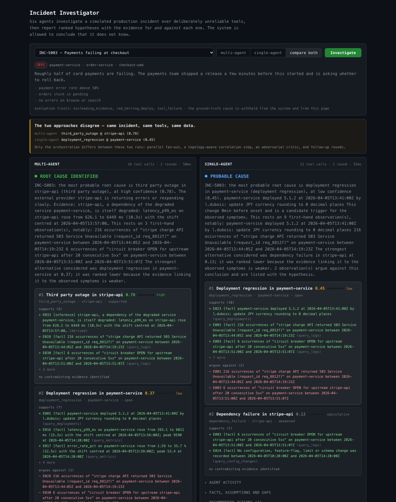
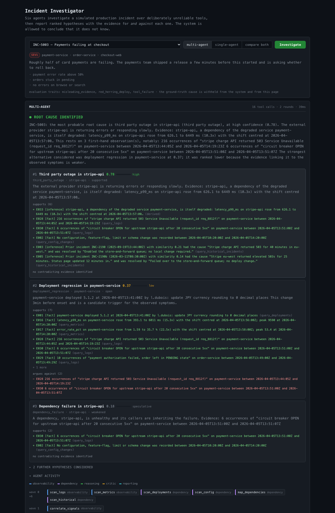
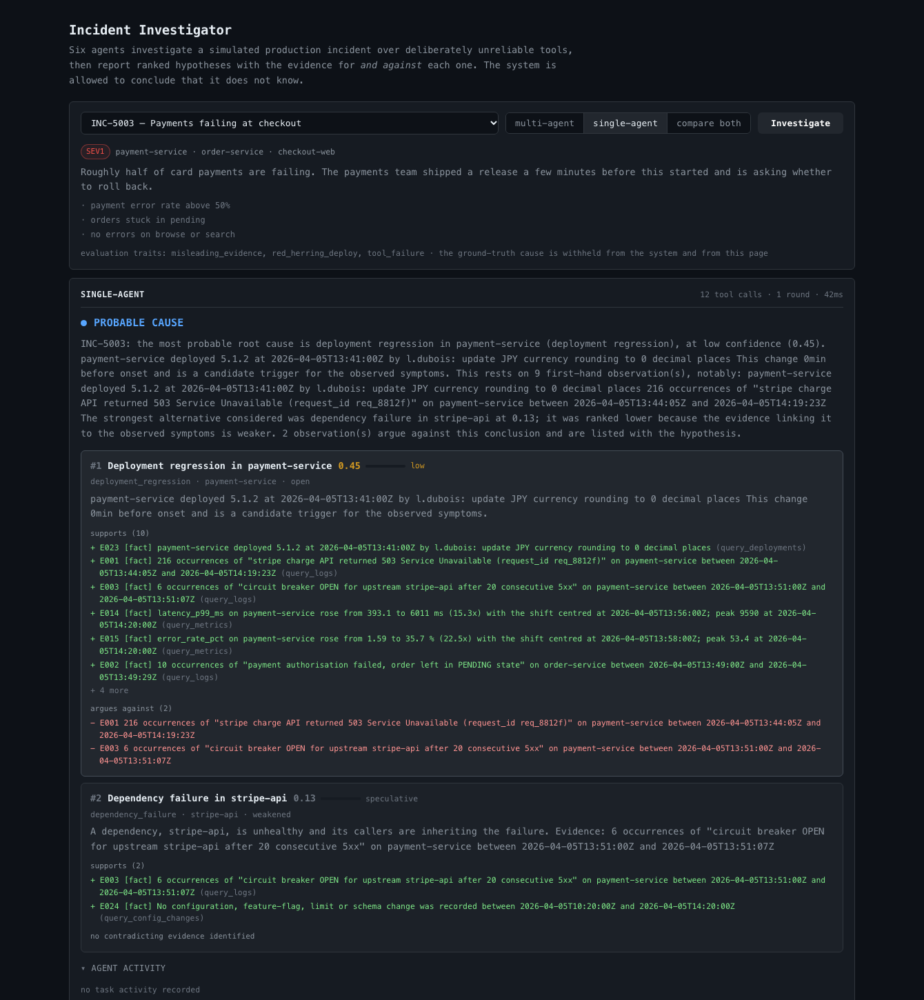
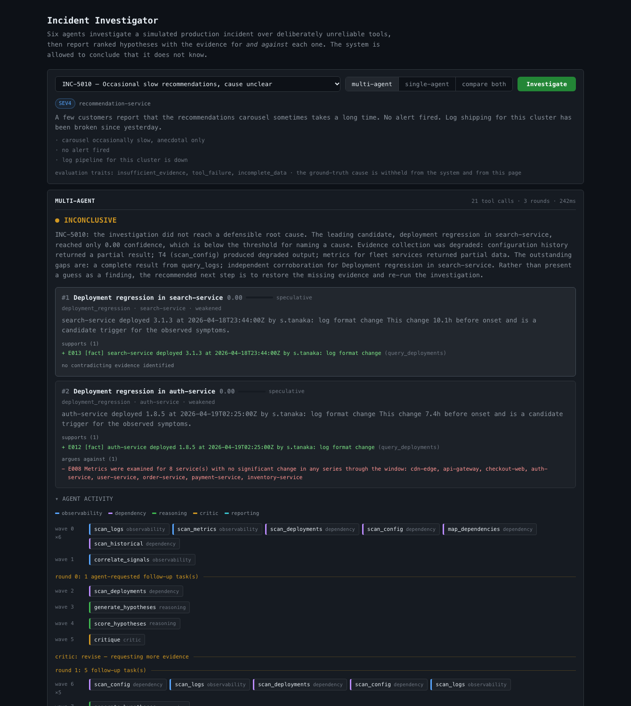
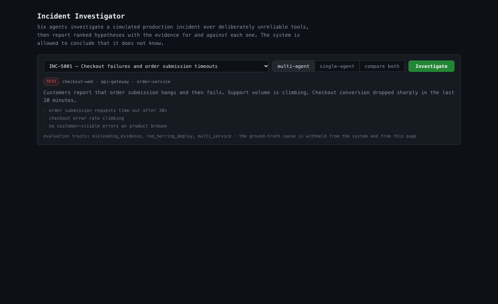

# Multi-Agent Production Incident Investigation System

Six agents investigate a simulated production incident over deliberately
unreliable tools, argue about what the evidence supports, and produce a report
with ranked hypotheses, the evidence for *and against* each one, explicit
separation of fact from assumption, and remediation actions tied to the
hypothesis they presume.

The system is allowed to conclude that it does not know.

**▶ Live: https://multi-agent-production.vercel.app**

Try the three cases that matter, no setup required:

| | What it shows |
| --- | --- |
| [INC-5003 · multi-agent](https://multi-agent-production.vercel.app/?incident=INC-5003&approach=multi-agent&run=1) | A deploy lands 3 minutes before the outage. The system blames Stripe anyway — correctly. |
| [INC-5003 · single-agent](https://multi-agent-production.vercel.app/?incident=INC-5003&approach=single-agent&run=1) | Same incident, same tools. The baseline blames the deploy. |
| [INC-5010 · inconclusive](https://multi-agent-production.vercel.app/?incident=INC-5010&run=1) | Not enough evidence, and the system says so instead of guessing. |

The deployment runs the deterministic engine, so those links return exactly the
numbers printed below and captured in the screenshots — a live investigation is
a pure function of `(seed, incidentId)`.

---

## It works — here is the proof

Every image and every block below is a real capture from this repository, with
the command that reproduces it. Nothing is mocked or staged.

### Both approaches, side by side, on the same evidence

The UI can run the multi-agent system and the single-agent baseline together on
one incident and show where they part company. `INC-5003` is the incident built
to catch a system that mistakes correlation for causation: the payments team
shipped a release minutes before the failures began, but the real cause is
Stripe returning 503s, and the release only touched JPY rounding, which never
executed.



```bash
npm run dev    # then: /?incident=INC-5003&compare=1&run=1
```

### The hard case: a deploy that lands 3 minutes before the outage

`INC-5003` is the incident designed to catch a system that mistakes correlation
for causation. The payments team shipped a release minutes before the failures
started — but the real cause is Stripe returning 503s, and the release only
touched JPY rounding, which never executed.

**Multi-agent** — gets it right, and demotes the release to #2 *with the
evidence that argues against it* shown in red:



```bash
npm run investigate -- INC-5003          # or open /?incident=INC-5003&run=1
```

**Single-agent baseline** — same incident, same tools, same data. It blames the
release, and ranks the real cause fourth-of-a-point below it:



```bash
npm run investigate -- INC-5003 --single
```

| | Multi-agent | Single-agent baseline |
| --- | --- | --- |
| Verdict | ROOT CAUSE IDENTIFIED | PROBABLE CAUSE |
| #1 | `third_party_outage @ stripe-api` **0.78** ✅ | `deployment_regression @ payment-service` **0.45** ❌ |
| #2 | `deployment_regression @ payment-service` 0.37 | `dependency_failure @ stripe-api` 0.13 |

### Knowing when not to answer

`INC-5010` has a mild latency wobble, a broken log pipeline, no deploy and no
config change. The correct answer is that there is no answer. The system says
so, separates what it established from what it assumed, and lists what it would
need:



```bash
npm run investigate -- INC-5010
```

### Watching the agents work

The report tells you the answer; the **agent activity** panel shows how it was
reached. Wave 0 fans six independent queries out at once, the reasoning chain
runs strictly in order behind it, the Critic refuses the conclusion, and a
second round opens underneath. Each task is coloured by the agent that ran it.



```bash
npm run dev     # http://localhost:3000
```

Any investigation is deep-linkable, which is also how the screenshots above are
captured from real runs rather than staged:

| Link | |
| --- | --- |
| `/?incident=INC-5003&compare=1&run=1` | both approaches, side by side |
| `/?incident=INC-5008&approach=single-agent&run=1` | one approach |

Layout is verified rather than eyeballed — `scripts/measure-layout.mjs` drives
Chrome over the DevTools Protocol and fails if the page overflows horizontally
at 430px. (Headless Chrome's `--screenshot` crops an overflowing page instead of
showing the overflow, so a screenshot cannot be trusted to reveal this.)

### Agents really do run in parallel

Wave 0 fans six independent queries out at once; the reasoning chain is then
strictly ordered; the Critic refuses the first conclusion and opens a second
round. Verbatim from `npm run investigate -- INC-5003 --trace`:

```
     1ms  plan          system         wave 0: running 6 task(s) in parallel
     1ms  task_start    observability  T1 scan_logs (attempt 1)
     3ms  task_start    observability  T2 scan_metrics (attempt 1)
     5ms  task_start    dependency     T3 scan_deployments (attempt 1)
     6ms  task_start    dependency     T4 scan_config (attempt 1)
     6ms  task_start    dependency     T5 map_dependencies (attempt 1)
     7ms  task_start    dependency     T6 scan_historical (attempt 1)
    47ms  plan          system         wave 1: running 1 task(s) in parallel
    47ms  task_start    observability  T7 correlate_signals (attempt 1)
    47ms  plan          system         wave 2: running 1 task(s) in parallel
    47ms  task_start    reasoning      T8 generate_hypotheses (attempt 1)
    49ms  plan          system         wave 3: running 1 task(s) in parallel
    49ms  task_start    reasoning      T9 score_hypotheses (attempt 1)
    49ms  plan          system         wave 4: running 1 task(s) in parallel
    49ms  task_start    critic         T10 critique (attempt 1)
    50ms  critic        critic         revise: Confidence in "Third party outage in stripe-api" is 0.78
                                       with 0 blocking and 2 major objection(s). Requesting 2 further
                                       investigation step(s) before accepting any conclusion.
    50ms  replan        orchestrator   round 1: 3 follow-up task(s) — close 2 evidence gap(s) named by the critic.
    50ms  plan          system         wave 5: running 3 task(s) in parallel
```

### Every ranking can be explained

No score is asserted without its arithmetic. From
`npm run investigate -- INC-5003 --trace | grep "score H"`:

```
score H01 (deployment_regression @ payment-service) = 0.403 [open]
  support 1.96 (from 10 link(s), raw 7.73) − contradiction 1.26 (2 link(s)) + structure 1.67 = 2.37
  corroborated by 4 independent tools (+0.75); mechanism signals [deploy] (+0.30); ...

score H02 (third_party_outage @ stripe-api) = 0.776 [supported]
  support 1.44 (from 6 link(s), raw 2.56) − contradiction 0.00 (0 link(s)) + structure 1.90 = 3.34
  corroborated by 4 independent tools (+0.75); mechanism signals [external_degraded, upstream_unhealthy] ...
```

Note that H01 has *more* supporting links (10 vs 6) and still loses. That is
deliberate: support saturates early so that ranking turns on mechanism
specificity and blast radius, not on volume of loosely-related evidence.

### Tests

```
$ npm test

 Test Files  5 passed (5)
      Tests  98 passed (98)
   Duration  2.37s
```

### Measured results

```
$ npm run eval -- --repeats=3 --sweep

metric                                  multi-agent  single-agent
------------------------------------------------------------------------------
root-cause accuracy (strict)                  1.000         0.750
correct cause in top 3                        1.000         0.917
evidence grounding                            0.964         0.957
  citation validity                           1.000         1.000
brier (lower better)                          0.035         0.098
abstained w/ cause available                      0             3
overreached on weak evidence                      0             0
tool calls / incident                          15.8          11.8
hypotheses considered                           6.7           2.4
rounds                                         1.61          1.00
```

Full tables, per-incident outcomes and the robustness sweep across three seeds
are in [EVALUATION.md](EVALUATION.md), regenerated by that command.

Raw captures of all of the above live in [`docs/output/`](docs/output/), and
every image and block on this page is regenerated by:

```bash
./scripts/capture-docs.sh
```

Re-running it produces **byte-identical** screenshots, because the deterministic
engine makes every investigation a pure function of `(seed, incidentId)` — the
same property that lets the evaluation below be a fair A/B rather than a
coin-flip.

---

## Quick start

No API key, no network, no services to stand up.

```bash
npm install
npm test                           # 98 tests
npm run list                       # the 12 synthetic incidents
npm run investigate -- INC-5001    # run an investigation
npm run eval                       # multi-agent vs single-agent, all incidents
```

The default reasoning engine is **deterministic** — a rule engine, not a model —
so a fresh clone is immediately runnable and every result is reproducible from
`(seed, incidentId)`. Running against a real model is a flag away (see below).

### Commands

```bash
npm run list                                    # the dataset
npm run show -- INC-5002                        # the incident as the system receives it
npm run investigate -- INC-5002                 # multi-agent investigation
npm run investigate -- INC-5002 --single        # single-agent baseline
npm run investigate -- INC-5002 --trace         # + full execution trace
npm run investigate -- INC-5002 --json          # machine-readable
npm run eval                                    # full comparison → EVALUATION.md
npm run eval -- --repeats=3 --seed=777          # repeat across seeds
npm run eval -- --only=INC-5003,INC-5008        # a subset
npm run typecheck
```

Useful flags: `--engine=heuristic|llm`, `--model=<id>`, `--seed=<n>`,
`--faults=<0..1>` (background tool fault rate), `--fast` (skip simulated tool
latency), `--verbose` (stream the trace while running).

### Reading a trace

Every scoring decision carries its arithmetic, so a ranking can always be
explained after the fact:

```bash
npm run investigate -- INC-5008 --fast --trace | grep "score H"
```

```
score H04 (thundering_herd @ redis-cache) = 0.912 [supported] ::
  support 1.94 (from 11 link(s), raw 8.51) − contradiction 0.00 (0 link(s))
  + structure 2.10 = 4.04; corroborated by 4 independent tools (+0.75);
  mechanism signals [cache_miss, throughput_spike, saturation] (+1.20);
  the suspect service itself shows the fault (+0.40)
```

### Running against a real model

```bash
cp .env.example .env
# set ONE provider key, then:
npm run investigate -- INC-5001 --engine=llm
npm run eval -- --engine=llm --concurrency=1 --only=INC-5001,INC-5003
```

Three providers are supported and auto-detected in this order — **Groq**
(`GROQ_API_KEY`), **Vercel AI Gateway** (`AI_GATEWAY_API_KEY`), **Anthropic**
(`ANTHROPIC_API_KEY`) — or pin one with `LLM_PROVIDER`. Defaults are
`openai/gpt-oss-120b` on Groq and `claude-sonnet-5-5` otherwise.

Model calls are schema-constrained (`generateText` + `Output.object` via the AI
SDK). If a call fails, that individual call falls back to the deterministic
engine and the run continues degraded rather than dead — and the trace names the
actual provider error, so a rejected request never looks like a model reasoning
badly. With no key configured, `--engine=llm` warns once and runs
deterministically.

#### Two things that bite with hosted inference

**Strict structured output.** Groq (and OpenAI-compatible endpoints generally)
accept only a subset of JSON Schema: no `propertyNames` (so no `z.record`), and
every property must appear in `required` (so no `.optional()` / `.default()`).
The LLM-facing schemas in `src/core/llm/llm.ts` are written to that subset —
every field required, `.nullable()` in place of optional, and genuinely
free-form data (a tool's arguments) carried as a JSON string that the tool
registry then validates. Relaxing this does not error loudly; it makes every
call fail and silently drop to the deterministic fallback.

**Tokens per minute, not requests.** Groq's free tier is **8,000 TPM**, which is
the binding limit here — roughly five calls a minute. Set
`LLM_TOKENS_PER_MINUTE` and `src/core/llm/throttle.ts` paces calls against a
sliding 60-second window instead of discovering the cap by absorbing 429s.
Prompts are bounded to match: the most load-bearing ~28 evidence items rather
than the whole ledger, chosen by epistemic type, reliability and signal
specificity.

> **Cost and time.** A full 12-incident × 2-approach LLM evaluation is ~250
> model calls. At 8,000 TPM that is roughly two hours. Use `--only=` and
> `--concurrency=1`.

---

## What is in the box

```
src/
  core/
    types.ts          every inter-agent message, as a Zod schema
    blackboard.ts     shared investigation state
    scheduler.ts      parallel DAG executor with degraded-dependency recovery
    budget.ts         wall clock / tool calls / tokens / tasks / rounds
    retry.ts          bounded retry, circuit breaker, timeout
    tags.ts           the shared signal vocabulary agents communicate in
    llm/
      engine.ts       the cognition interface both engines implement
      heuristic.ts    deterministic rule engine (default)
      heuristic-rules.ts  mechanism tables, signal specificity, playbooks
      llm.ts          schema-constrained model calls, heuristic fallback
  agents/             orchestrator, observability, dependency, reasoning,
                      critic, reporting
  tools/              6 tools + registry (validation, faults, retry, breaker)
  data/               topology, deterministic world generator, 12 scenarios
  baseline/           single-agent baseline
  eval/               grader + harness + report renderers
  cli.ts              the command line
app/                  Next.js app: 3 API routes + a minimal UI
tests/                98 tests
.claude/agents/       tester, debugger, fixer, scenario-author
```

### The six agents

| Agent | Owns | Tasks |
| --- | --- | --- |
| **Orchestrator** | the plan, rounds, budget, termination | — |
| **Observability** | logs and metrics | `scan_logs`, `scan_metrics`, `correlate_signals`, `targeted_probe` |
| **Dependency** | deploys, config, topology, history | `scan_deployments`, `scan_config`, `map_dependencies`, `scan_historical` |
| **Reasoning** | hypotheses (gathers nothing itself) | `generate_hypotheses`, `score_hypotheses` |
| **Critic** | the right to say "not yet" | `critique` |
| **Reporting** | the deliverable | `compose_report` |

See [ARCHITECTURE.md](ARCHITECTURE.md) for the diagram, the coordination model,
and why it is a blackboard rather than a chain.

### The six tools

`query_logs`, `query_metrics`, `query_deployments`, `query_config_changes`,
`query_dependencies`, `query_historical_incidents`.

All have Zod input *and* output schemas. Every call passes through one wrapper
that validates input, charges the budget, consults a circuit breaker, injects
faults, enforces a timeout, retries what is retryable, validates output, and
returns an envelope stating plainly whether the result is **complete**. An agent
never sees a raw throw from a tool.

Faults are injected from two sources: a background rate applied to every call
(`TOOL_FAULT_RATE`, default `0.12`) and per-scenario forced faults, so a given
incident reliably exercises a specific recovery path. Both draw from the seeded
RNG, so failures are reproducible.

---

## The dataset

12 incidents in `src/data/scenarios/`, covering deployment regression, cache
failure, third-party outage, memory leak, connection-pool exhaustion,
certificate expiry, feature-flag rollout, thundering herd, schema-migration
lock, DNS failure, upstream rate limiting, and one case where the honest answer
is **inconclusive**.

Traits in play, used for the per-trait accuracy breakdown:

- `misleading_evidence` — most incidents have a decoy, usually a deploy landing
  *closer* to onset than the real cause
- `conflicting_observations` — two sources disagree about the same shared
  resource
- `tool_failure` — forced timeouts, partial results and outages
- `incomplete_data` — truncated responses that must not be read as full ones
- `insufficient_evidence` — INC-5010, where naming a cause is the failure

Each scenario carries a `truth` block used **only** by the grader
(`src/eval/grade.ts`) after a run completes. It is never passed to an agent,
never reaches a prompt, and `tests/tools.test.ts` asserts that neither the
incident report nor the generated world contains it. The world itself is
generated deterministically from `(spec, seed)`, so both approaches investigate
byte-identical data.

---

## Evaluation

```bash
npm run eval                              # writes EVALUATION.md + EVALUATION.json
npm run eval -- --repeats=3               # three seeds per incident
npm run eval -- --seed=777 --faults=0.30  # harsher conditions
```

Current results, 36 graded runs per approach (12 incidents × 3 seeds). Full
tables in [EVALUATION.md](EVALUATION.md).

| | multi-agent | single-agent |
| --- | ---: | ---: |
| root-cause accuracy (strict) | **1.000** | 0.750 |
| correct cause in top 3 | **1.000** | 0.917 |
| evidence grounding | **0.964** | 0.957 |
| citation validity (no invented ids) | 1.000 | 1.000 |
| Brier score (lower better) | **0.035** | 0.098 |
| abstained when a cause existed | **0** | 3 |
| named a cause on insufficient evidence | 0 | 0 |
| hypotheses considered | 6.7 | 2.4 |
| tool calls / incident | 15.8 | 11.8 |
| latency / incident | ~110 ms | ~80 ms |

Holding under conditions the rules were not tuned against:

| seed / fault rate | multi | single | delta |
| --- | ---: | ---: | ---: |
| 20260401, 0.12 | 1.000 | 0.750 | +0.250 |
| 777, 0.30 | 1.000 | 0.583 | +0.417 |
| 31337, 0.45 | 0.833 | 0.583 | +0.250 |

Reproduce with `npm run eval -- --repeats=3 --sweep`.

Strict accuracy requires the top-ranked hypothesis to name both the correct
cause category and the correct suspect service — or to correctly report an
inconclusive outcome. The margin grows as tools get less reliable, which is the
retry, replan and degraded-dependency machinery earning its cost.

Two things worth not glossing over. The system is **not uniformly better**: at
the harshest setting it drops to 0.833, and both failures there are consequences
of tool outages rather than of reasoning — on one incident the dependency graph
was never retrieved, so a shared-resource fault could not be attributed to the
resource; on the other it abstained, which under a 45% tool failure rate is the
defensible answer.

And a perfect 1.000 on the default configuration is a **result to distrust, not
to celebrate** — it is 36 runs over 12 authored incidents, and the rules were
tuned against them. The robustness sweep below is the number that means
something.

Where the gap actually comes from: the baseline **abstained three times when a
cause was discoverable**, and considered 2.4 hypotheses per incident against
6.7. It is not that the baseline guesses wrong; it is that it stops looking.

---

## LLM mode: what was verified

The deterministic engine is the default and the source of every number above.
This section records exactly what the `--engine=llm` path has and has not been
shown to do, so neither is overstated.

**Verified working.** Provider resolution across Groq / AI Gateway / Anthropic;
schema-constrained generation; per-call fallback; the throttle; quota handling;
and the full six-agent investigation driven by real model calls. On `INC-5003`
— the incident whose trap is a deploy landing three minutes before onset —
`openai/gpt-oss-120b` reached `third_party_outage @ stripe-api`, correctly
rejecting the red-herring release, with every reasoning step served by the model
and no fallbacks.

**Not produced: a full LLM-vs-LLM comparison.** Four things had to be fixed to
get that far, and the fifth could not be:

| Finding | Response |
| --- | --- |
| Strict providers reject `z.record` (`propertyNames`) and `.optional()` / `.default()` (key absent from `required`) | LLM-facing schemas rewritten to that subset; guarded by `tests/llm-schemas.test.ts` |
| The AI SDK's own retry loop nested inside ours — 2 × 3 attempts, each absorbing a 60s `retry-after` | `maxRetries: 0`; the caller owns retrying |
| Quota classifier matched the `…/settings/billing` upsell footer, so a *transient* per-minute limit disabled the model for the whole run | Match only the stated limit window; unknown limits assumed recoverable |
| One global output budget truncated hypothesis generation into invalid JSON | Per-call output budgets; a tight allowance shrinks the **prompt**, never the output |
| **Groq free tier allows 1,000 output tokens/minute.** One hypothesis-generation call needs more than that to write, and a request above the allowance is rejected outright rather than queued | Not solvable without either a paid tier or shrinking the schemas enough to damage the system |

Each of the first four was a real defect that failed *silently* — the call was
rejected, the engine fell back, and the run looked like a model reasoning badly
rather than one that never ran. Surfacing the provider's actual error in the
trace is what made them findable, and is now permanent behaviour.

To run the real comparison on a tier that permits it:

```bash
LLM_TOKENS_PER_MINUTE=0 LLM_OUTPUT_TOKENS_PER_MINUTE=0 \
  npm run eval -- --engine=llm --concurrency=1 --max-seconds=300
```

Set both limits to your provider's actual values to enable pacing; set them to
`0` to disable client-side throttling entirely.

---

## Deploying to Vercel

Already deployed: **https://multi-agent-production.vercel.app**

To deploy your own:

```bash
npm i -g vercel
vercel link
vercel deploy          # preview
vercel deploy --prod   # production
```

Configuration is in [`vercel.ts`](vercel.ts) (Next.js, Fluid Compute, `iad1`).
`app/api/investigate/route.ts` sets `maxDuration = 300` because a full
multi-agent run against a real model takes well over the old default.

| Route | Purpose |
| --- | --- |
| `GET /api/health` | liveness, engine, whether a model key is configured |
| `GET /api/incidents` | the dataset as the system sees it (no ground truth) |
| `POST /api/investigate` | run an investigation |
| `/` | minimal UI: pick an incident, pick an approach, read the report |

```bash
curl -X POST http://localhost:3000/api/investigate \
  -H 'content-type: application/json' \
  -d '{"incidentId":"INC-5003","approach":"multi-agent"}'
```

Environment variables (`vercel env add`): `ENGINE`, `ANTHROPIC_API_KEY` **or**
`AI_GATEWAY_API_KEY`, `MODEL_ID`, `TOOL_FAULT_RATE`, `SEED`. With none set the
deployment runs the deterministic engine, which is why `/api/health` reports
`modelConfigured`.

Requesting `engine: "llm"` without a configured key is answered with a
deterministic run and `engineDowngraded: true` rather than a 500.

---

## Deliverables map

| Asked for | Where |
| --- | --- |
| Runnable implementation + setup | this file; `npm install && npm test` |
| Architecture diagram + coordination | [ARCHITECTURE.md](ARCHITECTURE.md) |
| Synthetic incident dataset | `src/data/scenarios/` (12 incidents), `npm run list` |
| Automated tests | `tests/` (98 tests), `npm test` |
| Evaluation vs single-agent baseline | [EVALUATION.md](EVALUATION.md), `npm run eval -- --sweep` |
| Technical note (≤500 words) | [TECHNICAL_NOTE.md](TECHNICAL_NOTE.md) (499) |
| Incomplete functionality + dependencies | below |
| Coding assistant transcript | [docs/AI_TRANSCRIPT.md](docs/AI_TRANSCRIPT.md) |

---

## Known limitations and incomplete functionality

Stated plainly, because the assignment asks for it.

1. **Headline accuracy was measured with the deterministic engine.** The
   numbers in `EVALUATION.md` come from the heuristic engine. The `llm` path
   has since been run against real models (Groq: `openai/gpt-oss-120b`,
   `openai/gpt-oss-20b`, `qwen/qwen3.8-27b`) and works end-to-end — see
   *LLM mode: what was verified* below — but **no full LLM-vs-LLM evaluation
   has been produced**, because the available free tier caps output at 1,000
   tokens per minute, which is less than a single hypothesis-generation call
   needs to write. The harness runs it unchanged with `--engine=llm` on a tier
   that allows it.
2. **The heuristic engine is a rule engine, and its rules were tuned against
   these 12 incidents.** It generalises across seeds and fault rates, but not
   necessarily to failure modes outside `RootCauseCategory`. An unseen
   mechanism will fall through to a generic category. This is the main reason
   to treat the deterministic numbers as a floor for orchestration value rather
   than as a claim about diagnostic breadth.
3. **Calibration is only lightly evidenced.** The system is now correct on all
   36 runs of the default configuration, so "confidence when wrong" has no
   samples left to compute from there. At the harshest setting it is still
   wrong twice. Confidence is a hand-set logistic, not a curve fitted to
   observed accuracy, and should be read as a ranking signal rather than a
   probability.
4. **Contradiction detection is narrow by design.** It fires only on two
   readings of the same metric on the same service, or on both ends of a shared
   resource (cache, database, queue, third party). A broader rule produced
   mostly false positives — different services legitimately differ.
5. **Edge kinds are inferred by name** in the reasoning layer
   (`kindOfEdge`) because the topology slice handed to the Reasoning agent does
   not carry them. This only widens or narrows which service pairs are eligible
   for a contradiction; it never changes what is reported.
6. **The world is synthetic and single-region.** No traces, no spans, no
   profiles, no saturation of hosts vs pods. Metrics are 1-minute resolution.
7. **No persistence.** Every run is in-memory; nothing is stored between
   requests. The API is stateless by design, which suits Fluid Compute but means
   no investigation history.
8. **The UI is deliberately minimal** — the assignment asks for no polished
   frontend. It renders the report and the metrics, and nothing else.
9. **One known residual failure.** On INC-5008 at the bare default seed
   (`npm run investigate -- INC-5008`), the system names `deployment_regression
   @ redis-cache` where the truth is `thundering_herd @ redis-cache`. It gets
   the suspect service right and the mechanism wrong. The cause is traceable:
   that scenario forces `query_metrics` to time out, which destroys the
   `throughput_spike` evidence the thundering-herd signature requires, leaving
   only generic change-proximity hypotheses. The Critic does flag it — the
   report carries the gap *"evidence that distinguishes deployment regression
   from memory leak"* — but the missing evidence is not recoverable at that
   seed. It is left in rather than tuned away, because a scenario quietly
   weakened until it passes is worth nothing.

### External dependencies

| Package | Why |
| --- | --- |
| `zod` | schemas for every tool and inter-agent message |
| `ai`, `@ai-sdk/groq`, `@ai-sdk/anthropic` | `--engine=llm` only; dynamically imported, so the deterministic path never loads them |
| `next`, `react`, `react-dom` | the deployable app |
| `typescript`, `tsx`, `vitest` | build and test |
| `@vercel/config` | types for `vercel.ts` |

The core system — agents, tools, blackboard, scheduler, evaluation — depends on
`zod` and nothing else. It runs with no network access.
